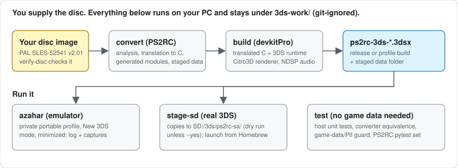

# GTA San Andreas 3DS Port

**Unofficial, experimental, not playable yet.** An experimental port of *Grand Theft Auto: San Andreas* (PS2, PAL disc
**SLES-52541 v2.01**) to the **Nintendo 3DS family - New 3DS / New 3DS XL / New 2DS XL and Old 3DS / 3DS XL / 2DS** -
built on the [PS2RC](https://github.com/SandstoneDev/PS2RC) PlayStation 2 recompiler runtime (devkitPro, libctru,
Citro3D, PICA200). You supply your own copy of the disc; no game files are included.
One universal build picks its profile at start-up: the full profile on New 3DS models (804 MHz, L2 cache, more
memory) and a [compact profile](docs/3DS_OLD_MODEL.md) on Old 3DS models (16-bit textures, smaller buffers, a static
geometry budget, modifier controls). New 3DS is the main target; Old 3DS is supported but slower, and neither has been
verified on real hardware yet.

> Based on PS2RC by SandstoneDev
> https://github.com/SandstoneDev/PS2RC
> Community: https://discord.gg/wV8x46ZTDu

This repository is a derived work of PS2RC and is distributed under the [PS2RC License](LICENSE) (source-available,
free of charge, no game data). The original README is kept as [README.PS2RC.md](README.PS2RC.md).
It is an independent fan project: **not affiliated with, authorised or endorsed by** SandstoneDev, Rockstar Games,
Take-Two Interactive, Sony Interactive Entertainment or Nintendo. "Grand Theft Auto", "San Andreas", "PlayStation" and
"Nintendo 3DS" are trademarks of their owners, used only to say what the software works with.

## Status: not playable

| Area | State |
|---|---|
| Translation + build | Works: the translated game builds as a 3DSX with devkitPro |
| Rendering (Azahar emulator) | Draws the city, HUD, minimap, characters, vehicles, fog |
| Speed (Azahar, New 3DS mode) | **~5-9 frames/s** in the measured gameplay route, ~4.5 in the busiest scenes (the game aims for 25). Not playable yet |
| Speed (Azahar, Old 3DS mode) | Slower than New; the GPU vertex paths cut its frame time by 14-17% (see status) |
| Input | A scripted pad route moves the player in Azahar. **Physical buttons are untested** |
| Audio | The sound-driver model runs; **no audible output has been verified** |
| Long play (Azahar) | A 35-minute scripted soak runs to 735 s of game time without stalls (the former 315 s stall is fixed) |
| Real hardware | **Not yet run on a real 3DS.** A hardware timing build is being tested; emulator speed may differ from hardware |
| Old 3DS / Old 3DS XL / original 2DS | Supported by the universal build (compact profile, 64 MB mode); forced `--model old3ds` remains available. See status for emulator checks and remaining geometry/memory limits. Not yet run on real old hardware |

Details, measurements and the open work list: [docs/3DS_STATUS.md](docs/3DS_STATUS.md).

### Recent updates (2026-11-17, all measured in the Azahar emulator)

* **Stability:** the gameplay stall at 315 s of game time is fixed at its source (an uninitialised point in a ped
  task fed a line-of-sight walk); a guard stays as a backstop.
* **Bottom screen:** an optional dual-screen HUD (radar, money, clock, wanted level, health/armour, weapon/ammo on the
  lower screen; `hud_layout = classic` restores the original layout).
* **GPU geometry, converted once and reused** (the idea REGTA/librw use): lit vehicles and props are lit by the GPU,
  peds are skinned by the GPU, and static buildings are transformed by the GPU; converted meshes are cached across
  frames and drawn by reference. Static conversion went from ~17 to ~5 ms per frame, busy-scene lit conversion
  roughly halved, and frames got 6-10% faster per step (14-17% on Old 3DS).
* **Frame pacing:** frames no longer wait for the 60 Hz cadence before rendering (-5..-11% per frame).
* Rejected after measurement (documented in the status page): `-O3` for the translated code, a frame-time detail
  controller, per-batch state de-duplication.



*Screenshots:* this repository intentionally contains no game screenshots or captures, because anything rendered
from the game is game-derived material the PS2RC license does not let us distribute. Diagrams and measurements only.

## What you need (and what you must not do)

* **Your own legally obtained copy of the disc: PAL "SLES-52541", version 2.01** (check with `verify-disc` below).
  Dump your own disc with an optical drive. This repository does not link to, host, or describe where to find disc
  images, and issues or pull requests that do will be closed.
* A PC (Windows 10/11, Linux or macOS), about **15 GB** free disk space, Python 3.11+, git, devkitPro, and
  WSL2 with pspdev (installer script included), or Docker, or a native pspdev toolchain for the conversion step.
* For hardware: a New 3DS / New 3DS XL / New 2DS XL (recommended) or an Old 3DS / 3DS XL / 2DS, with custom
  firmware, the Homebrew Launcher and about 4 GB on the SD card.

Everything made from your disc (translated C, staged assets, 3DSX builds, logs, captures) stays on your machine
under `3ds-work/`, which is git-ignored. **Never share, commit or upload any of it.** A heuristic guard script
(`3ds-port/scripts/check-no-game-data.py`, also run by CI) rejects common game-derived file types, personal paths and
encoded blobs; it is a safety net, not proof, so review your own changes too. Share logs only through
`3ds-port/scripts/summarize-log.py`, never raw.

## Quick start

```bash
git clone https://github.com/CheatoOfficial/gta-san-andreas-3ds-port.git && cd gta-san-andreas-3ds-port
python 3ds-port/ps2rc3ds.py doctor --fix          # checks/installs Python packages and 3DS libraries
python 3ds-port/ps2rc3ds.py verify-disc "path/to/your-disc.iso"
python 3ds-port/ps2rc3ds.py convert     "path/to/your-disc.iso" --use wsl   # ~10-30 min; or --use docker --pull
python 3ds-port/ps2rc3ds.py build                  # release 3DSX  (add --mode profile for the timing build)
python 3ds-port/ps2rc3ds.py test                   # host tests, no game data needed
python 3ds-port/ps2rc3ds.py azahar --azahar path/to/azahar.exe      # private emulator profile, minimized
python 3ds-port/ps2rc3ds.py stage-sd E:/ --yes     # copy the runtime to YOUR SD card
```

Full walkthrough, per-OS notes and troubleshooting: [docs/3DS_SETUP.md](docs/3DS_SETUP.md). Real-hardware test
plan (we especially need real frame-time logs): [docs/3DS_HARDWARE_TEST.md](docs/3DS_HARDWARE_TEST.md).
Legal notes: [docs/3DS_LEGAL.md](docs/3DS_LEGAL.md).

## Where things are

| Path | What |
|---|---|
| `hle/3ds/` | 3DS platform layer: boot, memory, input mapping, filesystem, timing |
| `games/SLES-52541_v2.01/engine/render/3ds/` | Citro3D renderer: vertex conversion, texture cache, state batching, PICA shader |
| `games/SLES-52541_v2.01/engine/sound/3ds/` | NDSP audio output |
| `mk/Makefile.3ds`, `mk/build.sh` | 3DS build rules |
| `3ds-port/` | Setup/build/test tooling, docs, developer tools |
| everything else | PS2RC itself (modified only where the 3DS port needed hooks) |

## Development and AI disclosure

Almost all of the 3DS port code, build tooling and documentation was written by AI coding agents, **Claude Code
(Anthropic) and ChatGPT Codex (OpenAI)**, working under human direction; a human supplies the disc, sets the goals,
runs the emulator/hardware tests and reviews results. It is not fully human-reviewed. Treat unverified claims in the docs accordingly, and please
report anything that is wrong. Contributions are welcome (see [docs/3DS_STATUS.md](docs/3DS_STATUS.md) for open
work); please say in your pull request if AI tools were involved.

Codex and Claude Code share [AGENTS.md](AGENTS.md). Start there and read [docs/HANDOFF.md](docs/HANDOFF.md) before continuing work.

## License

[PS2RC License 1.2](LICENSE) (unchanged), third-party notices in [NOTICE.md](NOTICE.md). No game data may ever be
added to this repository.
