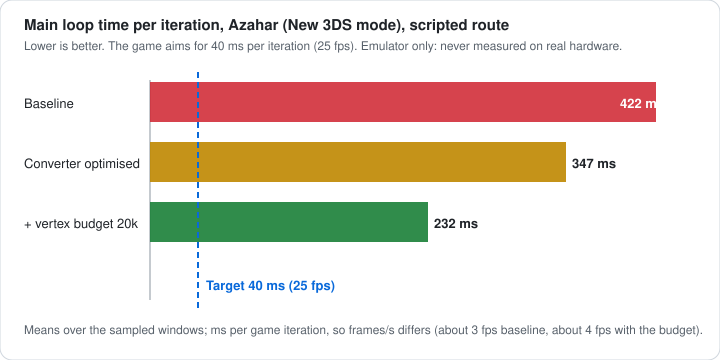

# 3DS port status and measurements

Last updated 2026-11-15. Unless marked otherwise, numbers come from the Azahar emulator (New 3DS mode, JIT, 100% clock, vsync on) on a
Windows PC, using a scripted pad route. **Nothing has been run on real hardware.** Emulator timing of float-heavy
code is probably pessimistic compared with a real ARM11 with VFP.

## What works (emulator)

* The translated game boots, passes the intro, reaches the city and runs its script.
* Citro3D renderer: textured world, HUD, radar, characters, vehicles, fog; lit/skinned geometry on the CPU.
* A scripted pad route moves the player (position changes are logged by the dev-pad probe).
* The IOP sound-driver model runs in lockstep (Azahar reports an NDSP error, so audio output is unverified).

## Setup reproduced from a clean clone (2026-11-15)

A fresh clone of this repository, on a Windows 11 PC with devkitPro and WSL2, ran: `verify-disc`, `convert --use wsl`
(analysis, translation, generated modules, staged data: all steps passed), `build` (release 3DSX, 11.66 MB), and
`azahar`: the release build booted in Azahar and drew frames (for example 34,542 triangles in a city frame) with no
fatal errors in the log. This found and fixed four setup bugs (xargs quoting under WSL, missing PATH for devkitPro's
shell, a missing texture-converter source, a diagnostic branch that broke release builds). Not reproduced: Linux/macOS,
Docker mode on this PC (Docker Desktop was not running), `doctor --fix` on a machine without devkitPro.

## Performance (the blocker)

| Step | Between presents | Main loop / iteration |
|---|---|---|
| Baseline | ~336 ms (~3 fps) | 330-650 ms |
| Vertex-converter optimisation (strip cache, hoisted lighting maths): 231 -> 128 ms per 3D frame in the hook | ~335 ms | ~347 ms |
| Static-vertex budget 20,000/frame (`--vert-budget 20000`) | 228-246 ms (~4 fps) | 175-275 ms |

* The game targets 25 fps (40 ms per iteration). Game logic is small (~35 ms/iteration).
* Largest remaining cost: two guest zones (`render_scene` and `camera_show`, ~120-320 ms and ~140-240 ms self time per
  iteration). They have no zoned children yet; the cause is not attributed.
* Citro3D submission is cheap (FrameBegin wait ~8-14 ms, submit 2-25 ms, FrameEnd 0.4 ms); the time is between presents.
* CPU vertex conversion: static ~0.8 us/vertex (40-65k vertices/frame uncapped), lit/skinned ~1.6 us/vertex.
  That is ~650 cycles per simple transform, implausibly high for real hardware, which is why we want a hardware log.
* Frame time also worsens over a run (e.g. 124 -> 718 ms between presents); cause unknown.
* The vertex budget skips whole meshes in draw order (not by distance); the one capture checked still looked intact.
* The Azahar-only draw-distance/detail preset (`ps2rc.cfg`) did not improve frame time.

## Not verified

Physical button input, audio output, sustained gameplay, missions, saving, real-hardware speed and memory (the game
is tight: linear heap free dips under 1 MB in Azahar), and the Old 3DS family. Nothing here supports "playable".

## Old-model profile (2026-11-15)

`--model old3ds` selects smaller bounded CPU/GPU buffers, a 2 MiB compact texture cache, an 8 MiB linear heap reservation
and modifier controls for consoles without ZL/ZR or a C-stick. The model has a separate object directory and named
artifacts; staging and Azahar also accept `--model old3ds`.

Both profiles have full-build and emulator observations below. All performance figures above predate this profile
and describe New-model observations. Real-hardware memory headroom, controls, audio and speed remain unverified.
See [3DS_OLD_MODEL.md](3DS_OLD_MODEL.md) for the acceptance plan.

**Baseline full builds and emulator runs (`20bee84`, before compact textures):** both models were built from a clean clone
and private local conversion outputs, and each matching release build was run in Azahar for about 4 minutes.

| | New-model build, New 3DS mode | Old-model build, Old 3DS mode |
|---|---|---|
| Linked image (text / BSS) | 11.57 MB / 13.64 MB | 11.57 MB / 6.58 MB |
| Heap at start (normal / linear) | 69,556 / 32,768 KiB | 72,352 / 8,192 KiB |
| Reached | city frames (1680+), same triangle counts as before the merge | city frames (2160+) |
| Texture omissions per sampled frame | 0 | up to 171; texture decodes refused ~43,000 times, linear heap down to ~0.8 MB |
| Frame pacing (between presents + submit) | ~200-340 ms | ~120-270 ms (fewer textures and vertices drawn) |

The Old-model build therefore boots and renders in the emulator, but with heavy texture loss: its 2 MiB texture cache
and 8 MiB linear heap are too small for this scene. Azahar's Old 3DS mode gave the homebrew 72 MiB of normal heap,
which a real Old 3DS homebrew launch may not, so these numbers do not establish real old-hardware memory headroom.

## Compact textures and draw-budget correction (2026-11-15)

Full New release, Old release and Old profile builds linked from private local conversion outputs. The final Old profile
(scripted input/captures, requested 300-second cap) and New release were run in separate fresh portable Azahar profiles,
with the matching hardware mode, JIT, 100% clock and vsync. They ran concurrently for correctness checks; these are not
comparable speed benchmarks. Tested artifact hashes matched the final local build outputs.

| Observation | Old profile / Old mode | New release / New mode |
|---|---:|---:|
| Last sampled world frame | 2040 | 2280 |
| Maximum texture omissions in sampled reports | 0 | 0 |
| Last reported texture decode/refusal failures | 0 | 11 (all pinned-cache refusals) |
| Last reported cache / peak | 1880 / 2048 KiB | 7670 / 7766 KiB |
| Minimum sampled linear heap free | 219 KiB (capture build) | 13,295 KiB |
| Normal / linear heap at startup | 73,276 / 8192 KiB | 69,548 / 32,768 KiB |
| Fatal log entries observed | 0 | 0 |

The earlier Old release reported up to 171 omissions per sampled frame and roughly 43,000 refused decodes. The new Old
profile keeps its 2 MiB limit but uses 512 metadata slots, bounded smaller images and 16-bit texels. World images are up
to 64 pixels / 8 KiB and HUD copies up to 128 pixels / 32 KiB. Local diagnostic captures showed the player, textured
environment, minimap and readable HUD text; no game captures are published here. Detail/color precision is lower than
New-model RGBA8. Old release BSS is now 5,637,424 bytes (about 5.64 MB); its decode scratch alone shrank by 983,040 bytes.

Raster lifecycle/unlock hooks now invalidate cache copies and defer freeing busy GPU snapshots. Header dimension/format
changes also invalidate a hit. New draws can temporarily be refused while an old snapshot is busy; zero sampled omissions
does not mean no transient omission occurred. Writes bypassing these hooks still need investigation if stale images recur.

A separate static-budget bug reserved all remaining frame vertices before returning for a skipped mesh. The budget check
now runs first, leaving capacity for later immediate/lit draws. A synthetic regression fails against the old production
backend and passes after the fix. Earlier inflated input counts must not be treated as fully drawn geometry. Draw-order
budget omission and real vertex/batch limits remain; the correction does not eliminate every skipped mesh.

A fresh emulator profile also exposed a startup path mismatch: staging places the boot ELF at the runtime root, but the
loader searched inside disc/. The loader now follows the staging layout, and both fresh-profile runs passed startup.

No real hardware was tested. Old-mode Azahar still provides more normal heap than a real Old launch may provide, and the
capture build's linear headroom is small. These runs establish neither whole-game playability nor hardware compatibility.

## Universal binary (2026-11-16, PR #3)

The default `--model auto` produces one binary with runtime-sized renderer storage. Its pre-main allocator uses the
remaining process allowance: 32 MiB linear when at least 88 MiB remains, otherwise 8 MiB. APT hardware detection then
selects compact resources on Old hardware; full resources require New hardware, 56 MiB normal and 32 MiB linear heap.
A low-memory New launch keeps New controls with compact resources. Insufficient normal heap stops startup. Forced
Old/New targets remain for regression checks. See [3DS_SETUP.md](3DS_SETUP.md) for artifact names and hardware selection.

Auto profile/release and forced Old/New release builds link. Universal release BSS is 2,061,688 bytes; dynamic renderer
allocations still consume memory after startup. Eleven host executables, eleven selected Python tests, 6,000 adapter
cases and ARM11 compilation for all three targets pass. Startup tests exercise the production allocator with fake SVCs,
including a 64 MiB total / 14 MiB used allowance, query/mapping errors and conservative New fallback.

The exact same final auto diagnostic artifact (SHA-256
`7635f4c1f2c4a898d81e03ce4a093f94d21dab92ff5d3dd1c37b254c879c4e17`) ran for about 291 seconds in each isolated Azahar
hardware mode. These concurrent host runs use scripted input and captures; they are correctness observations, not
comparable performance benchmarks or normal-controller tests.

| Observation | Old mode | New mode |
|---|---:|---:|
| Selected resources | compact | full |
| Normal / linear heap (KiB) | 76,768 / 8,192 | 80,864 / 32,768 |
| Periodic frame records / last sampled frame | 28 / 1,920 | 26 / 1,680 |
| Maximum sampled texture omissions | 0 | 0 |
| Maximum sampled skipped meshes | 153 | 0 |
| Last sampled cumulative decode failures | 0 | 0 |
| Last sampled cache / peak (KiB) | 1,986 / 2,048 | 13,341 / 13,341 |
| Minimum sampled free linear memory (KiB) | 219 | 7,342 |
| Fatal/abort/crash/panic entries in guest log | 0 | 0 |

The normal release artifact (SHA-256
`b3d0b52a121034e2897b29371b7ddd4ba2a47bcac6aa02c5408936e0733da3da`) also booted and rendered in both modes for
about 115 seconds: Old had 24 periodic records through frame 1,440, New 23 through frame 1,320. Neither guest log
had fatal/abort/crash/panic entries. No physical controls or normal-input gameplay was exercised.

Fresh captures through frame 1,720 were inspected privately in both modes: the player, city, minimap and HUD render.
Old geometry omission and detail loss remain visible. Its smaller static draw budget is preserved; zero texture omissions
does not mean full scene coverage. Old-mode Azahar provides a generous normal heap; the allocator fixture and emulator
runs do not prove the complete runtime fits a real Old launch. Compact capture runs have very little linear headroom.
No game captures, raw logs, generated sources or executables are included here. Real hardware, controls, audio, saving
and sustained gameplay remain unfinished.

## Present-pass fast path (2026-11-16)

Each frame, `hle_3ds_gfx_present()` re-checks, near-clips, divides and copies every converted world triangle into the
GPU vertex buffer on the CPU. On the profile route this cost a steady ~2.0 ms per 1,000 world vertices (the "submit"
timer), as much as the whole vertex conversion. Triangles entirely in front of the near plane (almost all of them)
now skip the copy-and-clip step; the finite check is one exact IEEE sum instead of 36 `isfinite()` calls; the
texture UV scale is applied while writing instead of in a second pass over GPU memory. Behaviour is unchanged.

Universal profile build, scripted route, private Azahar profile, New mode, before (`6fed0a1`) and after. The route is
deterministic: matching windows had identical vertex counts.

| Window (static + lit vertices) | Submit before | Submit after |
|---|---:|---:|
| 73,288 | 147.8 ms | 99.3 ms |
| 109,796 | 217.5 ms | 146.0 ms |
| 71,207 | 143.1 ms | 96.4 ms |
| 65,201 | 131.9 ms | 88.6 ms |
| 45,060 | 92.0 ms | 62.0 ms |

That is about 33% less present-pass time (1.35 ms per 1,000 vertices). Old mode on the same binary measured the same
per-vertex cost, 59 sampled frames, 0 texture omissions. Neither mode logged fatal entries. Frame time is still
dominated by conversion plus this pass (roughly 150-450 ms per frame in busy scenes), so the game is still not playable.

## Lit material preparation (2026-11-16, PR #5)

The next small CPU improvement prepares material unpacking, ambient/emissive terms and directional-light count once
per lit conversion call instead of once per vertex. Directional multiplication/addition order is preserved to avoid
changing rounded colour bytes. Geometry, skinning, primitive expansion, draw budgets and texture detail are unchanged.
This is stacked on the present fast path from PR #4; it does not move work onto the GPU.

Sequential universal profile builds ran the same scripted route in the same private Azahar New-mode profile.
Before is `9622a2f` (PR #4); after is `df8376b`. Matching windows had identical static/lit vertex and call counts.
The timer below covers lit conversion, not total frame time or only lighting arithmetic.

| Lit output vertices / calls per frame | Before | After |
|---|---:|---:|
| 53,131 / 243 | 76.2 ms | 68.1 ms |
| 89,706 / 501 | 138.9 ms | 125.0 ms |
| 51,071 / 267 | 81.8 ms | 73.7 ms |
| 44,742 / 244 | 69.4 ms | 62.4 ms |

This is about 10% less lit-conversion time in these windows, not a 10% overall-frame improvement. All four private
captures at frames 1,360, 1,480, 1,600 and 1,720 are byte-identical to the baseline. The larger conversion/present costs
still prevent a playability claim. Emulator measurements do not establish real-hardware performance.

An independent bitwise comparison against the pre-change converter passed 3,000 static and 3,000 lit/skinned cases.
A committed regression oracle exercises 12,000 material/light-state changes, zero normals, null lights, count clamping
and output colour clipping, with exact colour floats; the lighting-debug path also passes. Game-free tests and native
ARM11 compilation pass, and full universal profile/release builds link. The release was not runtime-tested in this pass.
No game data, builds, raw logs or captures are public.

The exact same candidate profile binary ran in New and Old modes, sequentially in isolated profiles. Each run recorded
28 periodic frame lines through frame 1,920, with zero sampled texture omissions, zero sampled adapter errors and no
fatal/abort/crash/panic guest-log entries. Old mode retains its existing compact detail/static budget (up to 153 skipped
meshes sampled); it remains tight on linear memory. Its fresh frame-1,720 capture was inspected locally and renders
the player, city, minimap and HUD. This is a regression check, not a matched Old-mode speed comparison. No hardware,
physical controls, audible output, saving or sustained gameplay was validated.

## GPU near-clip prototype (2026-11-16, build switch, off by default)

`HLE_3DS_GPU_CLIP=1 python 3ds-port/ps2rc3ds.py build ...` hands raw GE clip coordinates to the vertex shader instead of
near-clipping and scaling each triangle on the CPU. A fixed matrix (`hle_3ds_gpu_clip_rows`, composed with the existing
OrthoTilt) keeps X/Y/W identical and flips depth so the GE near plane becomes OrthoTilt clip z = 0, which PICA clips;
`C3D_DepthMap(true, 1, 1)` for the world pass restores GE reversed depth (near 1, far 0), and the sky/2D passes keep
the old mapping. The present pass is now a finite check and a copy per triangle. Known difference: geometry beyond the
GE far plane is clipped by the GPU instead of depth-clamped. Host tests check the mapping against the CPU path.

Same deterministic profile route as above, private Azahar profile, switch off vs on (PR #5 code otherwise):

| Window (static + lit vertices) | Submit, New, off | Submit, New, on | Submit, Old, off | Submit, Old, on |
|---|---:|---:|---:|---:|
| 109,796 / 65,244 (Old) | 146.0 ms | 67.3 ms | 87.7 ms | 40.8 ms |
| 73,288 / 56,011 (Old) | 99.3 ms | 46.6 ms | 75.3 ms | 34.9 ms |
| 65,201 / 47,249 (Old) | 88.6 ms | 41.1 ms | 65.3 ms | 30.7 ms |
| 45,060 / 32,224 (Old) | 62.0 ms | 29.2 ms | 44.7 ms | 21.0 ms |

About 54% less present-pass time in both modes (~0.61 ms per 1,000 vertices). Vertex counts per window and the other
timers were identical between builds. Four route captures (frames 1,360-1,720) differed from the CPU path in at most 3
pixels by at most 12 levels; four more around frame 1,920, where the CPU path near-clipped 11 triangles, differed in at
most 6 pixels by 1 level. Both modes: 28 periodic frame lines, 0 texture omissions, 0 adapter errors, no fatal entries;
Old kept its existing geometry budget skips. The busiest window is still ~337 ms per frame; lit conversion (125 ms) is
now the largest renderer cost. Azahar only: real PICA clipping/precision is unverified.

## GPU fog crossing correction (2026-11-16, PR #7)

Review of PR #6 found a fog mismatch at generated near-plane vertices. The reference CPU path clips first, then
computes visibility from the new view-space Z. The shader emits `(0.99609375 * visibility + 0.001953125) * W` and a
projective Q of W. Interpolating those shader outputs during GPU clipping does not reproduce evaluating fog at the
intersection. The [Azahar software clipper](https://github.com/azahar-emu/azahar/blob/master/src/video_core/renderer_software/sw_rasterizer.cpp)
models interpolation of both texture coordinates and projective W before perspective division; this is not hardware proof.

A synthetic, non-degenerate positive-W triangle demonstrates the difference: near=.1, vertex depths .05 and 100,
fog range 50..100. At the near intersection the reference visibility is 1, while pre-clipped projective coordinates
yield roughly .5. Existing short-route captures need not expose this larger-fog-gradient case.

PR #7 CPU-clips only fogged triangles crossing the near plane, then recomputes fog on generated vertices and submits
raw clip coordinates. All other triangles retain the prototype GPU path. The reference clipper is shared with host
regressions; default CPU rendering and the off-by-default prototype switch are preserved. Far-plane clipping still
differs from the reference's clamp, and real PICA behaviour remains unverified. Near-clipped/rejected diagnostics in
the prototype count CPU fallback work, not all GPU clipping or final GPU-generated triangles.

Fourteen host executables, eleven selected Python tests and 6,000 adapter-equivalence cases pass. The new synthetic
test covers all crossing masks, signed-zero boundaries, the projective fog counterexample and unchanged inside
vertices. Native ARM11 compilation passes with GPU clipping off/on for all three targets. Full on/off profile builds
and the default release build link; release execution was not tested in this pass.

The same fixed prototype binary ran in isolated Old/New Azahar modes concurrently. New recorded 30 periodic frame
lines through 2,160; Old recorded 32 through 2,400. Both have zero sampled texture omissions/adapter errors and no
fatal/abort/crash/panic guest-log entries. Both exercised 11 CPU fog crossings at sampled frame 1,920 and produced
fresh captures at 1,900, 1,910, 1,920 and 1,930. These are correctness checks; the earlier PR #6 speed numbers predate
this fallback, and this pass does not claim a new matched performance result. All game-derived evidence remains private.

A fresh New-mode CPU-reference run recorded 31 periodic frame lines through 2,280, with zero sampled texture
omissions/adapter errors and no fatal/crash entries. Its four near-crossing captures match the previous reference
byte-for-byte, supporting that the shared-clipper extraction preserved default rendering in these frames.
Compared with this fresh reference, the fixed prototype differs in 3, 0, 8 and 1 pixels at frames 1,900, 1,910,
1,920 and 1,930 respectively; maximum channel delta is one level. The near-camera wall/player/HUD frame was inspected
privately. This limited route comparison does not replace the synthetic fog-gradient regression or hardware validation.

Re-measured after the fix (Claude, same route, New mode, switch on vs off): busiest-window submit 146.0 -> 72.1 ms
(109,796 vertices), 99.3 -> 49.8 ms (73,288). The fallback costs ~5 ms against PR #6 alone; still ~50% less.

## Shader-side fog and UV scale (2026-11-16)

World vertices now reach the GPU exactly as the adapter converted them (`W3dC3dVertex` and the GPU vertex share one
layout, checked at compile time). The vertex shader takes the view-space Z in the former fog slot and applies two
per-batch uniforms: `fogparams` (`clamp(a*z + b, 0, 1)` from `hle_3ds_fog_linear`, equal to `hle_3ds_fog_factor` up to
float rounding; host test `fog_linear`) and `uvscale` (the texture's padding scale). The present pass no longer divides
for fog or scales UVs per vertex; 2D passes use no fog and unit scale. Both the default path and `HLE_3DS_GPU_CLIP=1`.

Measuring first (temporary private timers, not committed): in the busiest New-mode window with GPU clipping, the world
vertex loop was 55.5 ms of the 72.1 ms submit and the ~600 batches' state changes and draws 14.3 ms. A plain-copy
experiment bounded this change at ~11 ms, so the copy itself, not fog/UV, is what remains.

Same route, private Azahar, submit ms per frame (vertex counts and all other timers identical between builds):

| Window (New / Old vertices) | New, clip off | New, clip off + this | New, GPU clip | New, GPU clip + this | Old, GPU clip | Old, GPU clip + this |
|---|---:|---:|---:|---:|---:|---:|
| 109,796 / 65,244 | 146.0 | 135.3 | 72.1 | 58.4 | 40.8 | 35.6 |
| 73,288 / 56,011 | 99.3 | 92.7 | 49.8 | 41.2 | 34.9 | 30.7 |
| 65,201 / 47,249 | 88.6 | 82.3 | 44.0 | 35.9 | 30.7 | 27.0 |
| 45,060 / 32,224 | 62.0 | 57.7 | 31.2 | 25.6 | 21.0 | 18.6 |

(The Old columns are PR #6 code without the PR #7 fallback, whose route captures had no fogged crossings.)
Captures at frames 1,360-1,720 match the previous build of the same mode in all but one pixel (one level) for New
clip off, New GPU clip and Old GPU clip. Captures at 1,900-1,930 (frame 1,920 has 11 CPU fog crossings) are
byte-identical to the PR #7 New-mode captures. 0 texture omissions, 0 adapter errors, no fatal entries in every run.
Azahar only; real PICA float24 fog evaluation is unverified (differences would be sub-level in the fog ramp).

Also measured and not used: `mul255` without the division (exact shift form) saved only ~0.3 ms because most draws skip
it; skipping directional lighting entirely (`HLE_3DS_LIGHTING_DEBUG` on lit vertices only) saved 30.5 of 124.6 ms lit
conversion in the busiest window, the upper bound for moving directional lighting to the GPU. The guest-side
`hle.memtrap` zone (~22 ms/iteration) is scratchpad-to-RAM DMA register traffic (D8 CHCR/MADR/QWC/SADR, ~730 kicks
per iteration); its time likely includes interrupt work delivered at those safe points.

## Screened batch copy for GPU clipping (2026-11-16, `HLE_3DS_GPU_CLIP=1` only)

`convert_vertex` now keeps a running sum of each converted position, UV and view Z (non-finite if any of them is)
and notes any vertex not in front of the near plane; the backend stores the result per batch
(`w3d_citro3d_take_screen`, `W3D_C3D_SCREEN_*`). When a batch was screened finite and is unfogged or has no vertex
behind the near plane, every triangle would take the present pass's copy-as-is branch, so the batch is copied with
one `memcpy` (`gpu_batch_copies_as_is`). Other batches, and the unconverted "again" copies, keep the per-triangle
path. Without the switch the screen is compiled out (`UNKNOWN`) and the default build is unchanged. Host test `screen`
checks clean/NaN/infinity/behind cases against the per-triangle tests.

Same route, private Azahar, GPU clip on, compared with the shader-fog build above:

| Window (New / Old vertices) | New submit | New submit, screened copy | Old submit | Old submit, screened copy |
|---|---:|---:|---:|---:|
| 109,796 / 65,244 | 58.4 | 32.5 | 35.6 | 20.1 |
| 73,288 / 56,011 | 41.2 | 23.8 | 30.7 | 17.5 |
| 65,201 / 47,249 | 35.9 | 20.3 | 27.0 | 15.6 |
| 45,060 / 32,224 | 25.6 | 14.8 | 18.6 | 10.8 |

Screening costs ~3-4 ms of conversion in the busiest New window (lit 125.0 -> 127.8 ms, static 16.2 -> 17.0 ms), so
that window goes from ~329 to ~305 ms per frame (gap + wait + submit), and from ~343 ms on `main` with GPU clipping.
All captures (1,360-1,720 in both modes; 1,900-1,930 with 11 fogged crossings at 1,920) are byte-identical to the
previous builds. The default-switch build was re-measured: identical timings and byte-identical captures.

Double-buffered zero-copy was considered and not done: in this route the full profile's linear heap falls to
6.4 MiB free (14 MiB of textures cached, 20 MiB budget), so a second 8.25 MiB vertex buffer does not fit.

## Distance priority for the static budget (2026-11-16, compact profile and profile builds)

Idea borrowed (clean-room, no code) from the gtasands DS project's distance-banded map budget with fog matched to the
cut. The compact profile caps static geometry at 10,000 converted vertices per frame; before this, whichever static
draws the game submitted last were dropped (260-350 meshes per frame on the route), leaving holes in nearby walls and
floating building fragments. Now every static draw attempt adds an estimated vertex count (triangles x 3, calibrated
each frame against the real conversion output) to its 10 m band of origin depth; the next frame skips bands past the
one where the budget overflows and fills that band only with what the nearer bands leave (`w3d_citro3d_depth.h`).
The fog far distance follows the cut by at most 8 m per frame, never nearer than 100 m. Release New builds have no
static budget and are unaffected. Host test `backend_distance` covers the helpers and the far-before-near case.

Measurements behind the choice (private, New mode, busiest window): in this route the game already converts nothing
beyond ~150 m, and 85k of 90k lit vertices (122 of 128 ms) come from objects whose origin is within 50 m, so a plain
distance cap would not save meaningful time. 13% of lit vertices repeat a mesh and matrix within a frame, always with
a different material state.

Old mode, same route: static vertices drawn per frame 9.4-9.9k of 10k (draw-order skips 0-3 meshes, previously
260-350); submit and conversion times match the previous build within 0.5 ms. Four captures were compared side by
side privately: complete walls, fences, palms, poles and skyline where the previous build had holes and floating
pieces, with light distance haze. Azahar only.

## Dual-screen HUD (2026-11-17, `hud_layout = bottom`, 3DS default)

Reference: a public phone video of another New 3DS build of the game (watched 2026-11-16; no assets used). Its
bottom screen shows a large square radar on the left and a column with weapon icon, ammo, clock, money, health and
armour; the top screen keeps the picture, help box and zone name; cutscenes leave the bottom screen blank.

How: the HUD draw (0x2B01A0) already routes each element group through `src/hle_hud.c` handlers (sites.def). On the
3DS the status/wanted group (0x2AB500 / 0x2AA4D0) and the radar (0x2AC960) get `hle_hud_screen = 1` and a transform
into the bottom screen; the 2D back-end tags those primitives and draws them on a second Citro3D target (240x320,
cleared black every frame). Help box, subtitles, script text, zone/vehicle names, menus and loading screens are
outside those groups and stay on the top screen. Twenty element calls inside the status draw and twelve inside the
radar draw are routed too (`hud_sub_N`): each status element (weapon icon, clock, money, health/armour/breath bars,
ammo) gets its own place in the column, and the four quarter sprites of the black radar ring are left out so the
radar is square; radar primitives are scissored to the 240x240 px panel. Element positions on the PS2 screen were
measured from per-group/per-element bounds the build logs every 120 frames (`hud bounds`).

The bottom screen is taken from the text console at the game's first frame (boot messages stay readable until then)
and given back on exit. `hud_layout = classic` (player setting, re-read every frame) keeps the original single-screen
HUD. Also fixed: `HLE_3DS_RGBA8` packed red into the low byte, so render-target clears were red (now 0xRRGGBBAA).

Checked in the private emulator (New mode, both screens captured): gameplay frames 1,360-1,720 (radar, fist icon,
clock, money, health; live clock and money updates), intro cutscene at frame 1,050 (bottom blank), gameplay fade-in at
1,200, the pause menu opened by the scripted pad at 121 s (top: the complete Map page; bottom blank) and resumed at
127 s (HUD back, zone name on top), and `hud_layout = classic` (original HUD on top, bottom untouched). Not yet seen:
ammo, armour, breath and wanted-level placement (the route never shows them; their placements are estimates until
their logged bounds are observed), Old mode, hardware. Azahar only.

## GPU transform and lighting for lit meshes (2026-11-17, `HLE_3DS_GPU_LIGHT=1`, needs `HLE_3DS_GPU_CLIP=1`)

Where the lit time goes (private, New mode, busiest window, 89,706 lit output / 44,170 input vertices per frame, all
strips, 43% skinned at ~1.6 bones): removing one stage at a time from 130.5 ms (with counters) saved decode 21.9 ms,
skinning 21.5 ms, `convert_vertex` (camera/world transform, UV, colour) 25.8 ms; directional lighting was ~30 ms.
No single CPU stage dominates, so the transform and lighting moved to the vertex shader.

How: lit meshes write the skinned object-space position into the position slot and the object-space normal into
the colour slot (same 44-byte vertex, same present path and bulk copy); the backend keeps a `W3dGpuLight` per batch
(world matrix, camera projection, the adapter's prepared lit terms and the material step of `apply_simple_light`).
The shader (bool `litmode`) multiplies by screen x camera x world, computes view z for fog, normalises the world
normal, evaluates the same lit formula with byte rounding (Codex's probe: 64/64 exact in Azahar) and the material
step. The conversion screen also runs on GPU-lit vertices (near plane through camera x world): a call with a
non-finite value, or a fogged vertex behind the near plane, is redone on the CPU path. Decode and skinning are shared
with the CPU path (`lit_decode`), whose arithmetic is unchanged (6,000 adapter cases still bit-exact).

| Window (vertices) | Lit ms, CPU | Lit ms, GPU light | Between presents, CPU | GPU light | Submit, CPU | GPU light |
|---|---:|---:|---:|---:|---:|---:|
| 109,576 | 127.8 | 85.7 | 265.7 | 223.5 | 32.1 | 34.4 |
| 72,910 | 69.7 | 44.6 | 182.4 | 157.3 | 24.1 | 25.2 |
| 70,777 | 75.3 | 51.8 | 201.9 | 178.5 | 21.6 | 22.8 |
| 64,283 | 63.8 | 43.2 | 187.8 | 167.2 | 20.0 | 21.1 |

The busiest window's frame (between presents + wait + submit) goes from ~306 to ~266 ms (-13%); uniform uploads add
~1-2 ms of submit. 0 CPU fallbacks on the route. Captures against the same build with CPU lighting: frames
1,360-1,720 differ in at most 3 pixels by at most 2 levels; frames 1,900-1,930 (11 near clips at 1,920) in at most 6
pixels by 1 level; bottom screens identical. A first build ended the lighting procedure with END, which stops the
whole PICA shader (a called procedure returns after its last instruction): lit objects came out flat fog colour.
Off by default with GPU clipping; Old mode and hardware not yet checked.

## Audio output path in the emulator (2026-11-17, diagnostics only)

NDSP's `0xd880a7fa` in Azahar is the missing DSP component: libctru reads `sdmc:/3ds/dspfirm.cdc` (normally dumped from
the console with DSP1). With a 1 KiB placeholder file (zeros and the "DSP1" magic; created only in the private
emulator profile, not distributable firmware) Azahar's HLE DSP accepts it, NDSP initialises and the full SPU2
decode/mix path runs instead of the state-only model: about +11 ms per frame (`hle.audio` ~11 ms per iteration),
so all earlier emulator timings exclude audio mixing that a console with the component pays.

`audio_3ds.c` now logs the NDSP queue every 10 s of produced audio. NDSP consumes in real time (~48 k frames per
second of system time) and never stalls, but production follows virtual time: before the first main-loop iteration
(intro, logos, loading: about the first 45 s of virtual time) virtual time is deliberately unpaced and ran about
2x faster than real time, so ~60% of that audio was dropped for want of a free buffer; in gameplay the game is far
slower than real time, so the stream will underrun. Expect garbled intro audio and choppy gameplay audio on hardware
until the frame rate improves or the audio is paced/stretched to real time. The 3DS pacing clock counts from console
power-on (no origin, unlike the PSP's boot-relative clock); aligning it with virtual time changed nothing measurable
here (pacing is not reached in either phase), so that change was not kept - check it if x_pace is enabled.

## Real-time pacing and the audio queue on the 3DS (2026-11-17)

The NDSP queue held 16 x 256 frames; the audio model renders a whole sound-driver update at once, so about half of
the gameplay audio found no free buffer. With 96 buffers (0.5 s, 96 KiB linear) no gameplay audio was dropped on the
route (private Azahar with the placeholder DSP component), at ~+1 ms per frame.

The pack's existing pacing (`hle_bootpace.h`, `src/hle_bl.h`) fits the 3DS problems exactly; both were opt-in:
- `x_bootpace=1`: the loading screens/intro (virtual ~10-40 s) ran at ~2x real time (30 s of virtual time in ~14 s;
  intro music cut); with it they run at 1x (25 s in 25.6 s), lag forgiven 29-34 s at idle points.
- `x_pace=2`: in gameplay the 3DS is far below the game's 25 fps, so virtual time, the game clock and the audio model
  fell behind real time (audio ~30% of real time = mostly silence between bursts). With it, the pack's clock log
  shows virtual and game millisecond clock at x0.99-1.00 of real time, the in-game clock at 1 game minute per real
  second, 5.2-6.4 fps in gameplay in Azahar (physics x0.3: the game clamps its timestep at 60 ms), and audio produced
  at real-time rate (~20% still dropped in Azahar, plausibly its host-paced DSP against the emulated clock; check on
  hardware).
Both are now the defaults in 3DS release builds only (profile builds keep 0 so frame timings stay deterministic and
comparable); `ps2rc.cfg` overrides. Verified in a release build with no cfg: 'config: x_pace=2' and
'boot pacing: x_bootpace=1' logged, loading at 1x.

## Where gameplay frame time goes, and the GPU-lit conversion cache (2026-11-17)

Profile attribution (private Azahar, New mode, scripted route, profile builds; temporary zones under 0x2EF270, since
removed): the "weather / effects" label on 0x2EF270 was misleading. Its 30-60 ms of self time sat in 0x369E18 (the
driver's Im3D RenderIndexedPrimitive) and below it in 0x36B968, the driver's pipeline executor, because the HLE
immediate-mode draw (`hle_w3d_imm.c`) first flushes every deferred building batch (`w3d_defer_flush`). Per main-loop
iteration (141-175 ms): render pipeline incl. that flush 61-86 ms (static conversion ~17 ms, lit ~10-25 ms, the
rest per-batch work), camera_show 18-22 ms, audio ~10 ms, render_list_build ~7 ms. Most lit vertices are skinned
peds (7k-12.5k per frame against 1.7k-11.7k non-skinned).

GPU-lit conversion cache (`w3d_citro3d_adapter.c`, `HLE_3DS_LIT_CACHE`, default on; 3 MiB on the full profile, off on
the compact one): with GPU lighting a non-skinned lit vertex is object-space data, so a converted range is kept and
copied on the next draw. The key includes a hash of the vertex bytes and primitive words read, so reused memory is a
miss; only the per-draw near screening is redone. Host test (`adapter-equiv`): 300 random cases, miss / hit /
uncached outputs bit-identical, changed vertex at the same address never served (both GPU_CLIP settings).
Same route, same frames (identical vertex counts), lit conversion per frame before -> after: 20.9 -> 16.0,
10.5 -> 10.1, 10.7 -> 10.1, 14.7 -> 13.7, 24.6 -> 20.1 ms; between presents 143.5 -> 138.6, 114.5 -> 114.0,
122.4 -> 121.8, 137.6 -> 136.7, 152.8 -> 148.4 ms. Hits cover almost every non-skinned range; the remaining lit time
is CPU skinning. A small win (0.5-5 ms per frame) in Azahar; not measured on hardware.

GPU skinning (`HLE_3DS_GPU_SKIN`, build switch, default 1; acts with GPU lighting): a skinned lit range whose vertices
have at most three non-zero bone weights (summing to 1 within byte quantisation) is sent as bind-pose position /
normal with the (bone, weight) pairs packed into the three spare floats, and the shader (`vshader.v.pica`, skin
procedure, `bones[24]` uniforms) blends it; other ranges keep CPU skinning. The output no longer depends on the bones,
so skinned ranges are cached too. Near screening for these ranges is conservative (every used bone x every corner of
the bind-pose bounds). Host test: 300 random skinned meshes, the shader's arithmetic emulated from the packed output
matches CPU skinning, cached redraws keep the data and take the new bones, 30 four-weight meshes take the CPU path.
Azahar, same route and frames, GPU skinning off -> on (lit cache on in both): lit conversion 28.6 -> 19.9 ms
(53k lit verts), 66.6 -> 47.6 (90k), 43.2 -> 27.5 (51k), 33.8 -> 21.6 (45k); between presents 150.9 -> 142.2,
214.5 -> 195.5, 180.0 -> 164.3, 167.5 -> 155.2 ms. Captures at frames 3000-4800 (CJ in the foreground): both screens
pixel-identical. CPU-skinned remainder ~0.3k verts per frame. Not measured on hardware (Azahar runs the PICA shader
on the host, so the GPU side of the cost is not represented).

GPU static path (`w3d_citro3d_convert_mesh_range_gpu`, with GPU lighting): static (prelit) ranges are sent as
object-space vertices (position, colour bytes / 255, scaled UV) with camera x world as the batch matrix and
convert_vertex's material step (lamb / lemis, byte-rounded like mul255) in the shader (`objmode`, `post` procedure).
The data is cached with the lit ranges (cache budget raised to 5 MiB on the full profile); the same per-vertex near
screening and CPU fallback as GPU-lit. Host test: 300 random static meshes, the shader's arithmetic emulated from the
output matches the CPU conversion (clip, colour within one level, UV, view z), cached redraws identical.
Azahar, same frames, before -> after: static conversion 16.6 -> 7.9, 16.8 -> 7.9, 16.6 -> 7.9, 17.9 -> 8.1,
18.1 -> 8.0 ms per frame (19.5k-19.9k static verts, ~95% served from the cache, 0 CPU fallbacks); between presents
142.2 -> 133.6, 195.5 -> 186.9, 164.3 -> 155.8, 155.2 -> 145.9, 136.4 -> 126.5 ms. Captures: bottom screen identical,
top screen at most 20 pixels differ by one level (GPU rounding). The remaining static time is mostly copying cached
vertices (twice: into the frame buffer, then the present pass); drawing straight from the cached buffers is the next
step. Not measured on hardware.

Vertex-cache hits by reference: a hit no longer copies the stored vertices into the frame buffer; the batch points
at the cache entry (pinned until that frame is presented, so eviction skips it) and the present pass copies it into
the GPU buffer once. Host test: a hit leaves the output untouched and returns the stored data, and a pinned entry
survives cache pressure within its frame. Azahar, same frames, before -> after: static 7.9 -> 5.4, lit 20.0 -> 13.1,
47.9 -> 37.4, 27.7 -> 21.8 ms; whole frame (between presents + wait + submit) 168.3 -> 159.0, 230.7 -> 218.1,
188.1 -> 179.0, 176.1 -> 168.0, 150.7 -> 145.6 ms; captures pixel-identical. A 35-minute soak with the GPU paths
(before this change) ran to virtual 735 s (17 366 iterations): no stall / fatal / clamp, cache steady at ~4 MiB,
minimum linear free 5.9 MiB.

Frame begin without the 60 Hz pacing: `C3D_FrameBegin(0)` instead of `C3D_FRAME_SYNCDRAW`. Without
`C3D_FRAME_NONBLOCK` citro3d still waits for the previous frame's GPU work (the vertex-buffer guarantee); SYNCDRAW only
added C3D_FrameSync, a wait for the 60 Hz frame cadence that cost ~half a vblank per frame while frames take far
longer than 16.7 ms. Azahar, same frames: FrameBegin-wait 7.8-10.8 -> 0.0 ms in every window, everything else
unchanged (whole frame -5..-11%), captures pixel-identical. On hardware the GPU wait itself (real GPU work) can remain.

Old 3DS (compact profile, no vertex cache), same route and frames, GPU lighting off (CPU lit/static reference) ->
on (GPU lighting, skinning and static paths): lit conversion 69.5 -> 40.8, 93.7 -> 60.8, 74.7 -> 48.4 ms; static
8.4 -> 5.5 ms; between presents 181.5 -> 149.9, 230.5 -> 194.7, 201.1 -> 172.0, 179.3 -> 153.9 ms. Captures: bottom
screen identical, top at most 21 pixels one level apart. Minimum linear free unchanged (124 -> 123 KiB). Azahar only.

Submit-time split (profile timing line, "world draw calls"): of 14-36 ms submit per busy frame, the world draw-call
loop is 5-18 ms, the rest the copy / clip pass and the sky. Rejected experiment: skipping per-batch state and uniform
uploads that equal the previous batch's cut the draw-call loop by 1.0-2.6 ms with pixel-identical captures; the
whole frame (between presents, which excludes the present itself, + wait + submit) shrank by the same 1.3-2.6 ms of
~165-230 ms (~1%), judged not worth ~60 lines of state tracking, so it was reverted (diff kept privately).

Rejected: `-O3` for the generated code (`Y_GEN=-O3`, text 11.6 -> 12.05 MB). Azahar, same route: whole-frame times
equal to -O2 within 0.3 ms in every window, but the captures differ (~496k pixels over 10 frames), i.e. the
translated code's results changed; with no measured gain and changed behaviour, -O2 stays. (Azahar does not model
the ARM11 instruction cache, so code-size effects of optimisation levels need hardware.)

Rejected: frame-time driven static detail (`x_autodetail=<fps>`: the static vertex budget followed the smoothed frame
time, 10% down / 5% up every 15 frames, floor 12k). Azahar at target 8 fps: the budget sat at the floor, the
distance cut and fog came in to 30-80 m, and the whole frame improved only 3-6 ms (2-4%). With static conversion now
cheap, cutting static geometry no longer buys much; REGTA's budgets pay off because they cut game-side work (crowds,
traffic, LOD), which here is the translated game code. Reverted (diff kept privately).

Experiment, not enabled: `x_texup=0` (ps2rc.cfg; `hle_render.c`) skips the driver's GS texture-cache access 0x368B58,
which places rasters in GS memory and builds upload packets (0x34EAF8) that this renderer never uses; the profiler
puts it at 8-14 ms per iteration (sampled, ~35 us per call, 245-425 calls). A run with it showed correctly textured
3D frames and a complete bottom-screen HUD, but skipping guest code changes the virtual time per frame, so the
scripted route diverged (CJ ran into a wall) and neither pixel nor timing comparison with the reference is valid.
Default stays 1 (the original); it needs a non-scripted visual check (or hardware) before any default change.

## Soak stall at virtual 315.76 s (2026-11-17)

The first 70-minute soak (HUD + GPU light, scripted route: cheats, then sprinting back and forth in the train tunnel
with two wanted stars) stopped advancing the main loop at iteration 6875 (virtual 315.76 s); Codex's triage
(private `CODEX_SOAK_TRIAGE.md`) pointed at `world_process`. A stall watchdog was added to profile builds
(`hle_main.c`, `HLE_STALL_WATCH_S` / `HLE_STALL_EXIT_S`): it reproduced the stall at the same iteration and virtual
time in three runs and two emulator copies, in thread 1 at the back-edge 0x27F580 of 0x27E180 (called from 0x1FAF20).
0x27E180 walks the 120 x 50-unit world sectors along a line (row = floor(y / 50 + 60)); the stalled loop counts rows
without clamping. Its start vector was (1.62e29, 0, 1): the saturated row index made the loop run ~2^31 times.
Root cause (soaks 5-9 and the translated code): the bad endpoint (raw words 70030c01 00000000 3f800000; x = 1.62e29,
y 0, z 1.0) is uninitialised stack. The ped task code at 0x40D8D0.. calls 0x50DAA0(ped, entity, position, out = sp+0x80),
ignores its return value, adds 1.0 to out.z and walks a line of sight from out (0x27E180). 0x50DAA0 returns 0 on
several paths without writing out; two of its three callers (0x40DAB0, 0x40E2F4) ignore that. On a PS2 the stale
stack evidently holds something harmless; on this port it held 70030c01 at virtual 315 s of the soak route.
(The ra 0x1FAF28 the guard first logged is stale - the script dispatcher's call; translated code writes ra back only
when needed. The last dispatched script command was 0001 WAIT in 'main', i.e. not a script path.)
Fix: `src/hle_world_guard.c` hooks 0x50DAA0 and pre-fills out with the input position before the original runs, so
an unwritten output is a real point; when the original writes, it wins. The line-walk clamp stays as a backstop.
Soak 9 (fix + clamp, same route, New mode, Azahar): 0x50DAA0 returned 0 four times (virtual 305.4, 312.4, 316.1,
316.8 s), each time with the pre-filled position; the line-walk clamp never fired; the run ended at its time limit at
virtual 435 s, main-loop iteration 9896, no stall/fatal/adapter-error lines; one frame (10080) omitted one texture
(pinned_fail 84 -> 85, a slot still held by an in-flight frame - the known texture-cache behaviour; clean before and
after). Not yet run on hardware.

Backstop (added first, kept): `src/hle_world_guard.c` also hooks 0x27E180 and clamps an endpoint's x/y to +-3100 only
when it is not finite or more than 100 000 units out; valid endpoints (within +-3000) are untouched and the original
runs. With it, the same soak logged one clamped endpoint at virtual 315.341 s and kept going: main-loop iterations
6991 at 320 s, 7116 at 325 s, 7241 at 330 s (previously frozen at 6875). The 32-minute run ended at its time limit at virtual
580 s with 13 491 main-loop iterations, one clamp in total, no stall/fatal/adapter-error/texture-omission lines and at
least 5.9 MiB linear free (New mode, Azahar).

## Known issues from the pre-publication review (2026-11-15)

* Fixed: vertex buffers are now written only after the previous frame's GPU work has finished; texture slots used by a
  submitted frame stay protected until that frame completes; stereo audio buffers report frames, not halfwords; the ELF
  loader rejects segments with file size above memory size; palette reads are bounds-checked; raw guest bytes are no
  longer logged. None of these fixes could be validated on real hardware; Azahar does not establish physical GPU timing
  or audible hardware output, so treat GPU/audio behaviour as unproven.
  Measured effect in Azahar (same scripted run, release build): identical triangle and batch counts per frame, same total
  frame time, but 5 texture decodes were refused early in the run (`pinned_fail` 0 -> 5) because the slot was still in
  use by the previous frame, and the CPU vertex build no longer overlaps the GPU's previous frame (it now waits first).
* Raster lifecycle/unlock invalidation is now connected to the 3DS cache with deferred retirement. Writes outside those
  hooks and more complex streaming/lifetime cases still need investigation; the short runs do not prove complete coverage.
* Saving is currently disabled on 3DS: the platform memory-card configuration always reports no card and its filesystem
  operations are stubs. It needs implementation and end-to-end save/load testing, not just a hardware check.
* Open: the converter's `ps2rc/convert/toolchain.py` batch runner is inherited from upstream and was only hardened
  for paths with spaces by quoting; unusual path characters are untested.

## Open work (good first contributions)

Complete the Old-model acceptance checks and current review in [HANDOFF.md](HANDOFF.md) before claiming compatibility.

1. **Get a hardware profile log** ([3DS_HARDWARE_TEST.md](3DS_HARDWARE_TEST.md)). It decides what comes next.
2. Attribute the `render_scene` / `camera_show` self time (add profiler zones around the HLE hooks, flush, state and
   draw logic in `games/SLES-52541_v2.01/engine/render/hle_w3d*.c` and `3ds/`).
3. If hardware is also slow: move the static-mesh transform onto the PICA vertex shader (per-draw uniform matrices,
   cached float vertex buffers, strip draws) and reduce per-batch state work.
4. Distance/priority-aware budget (player and vehicles first, then the map by distance) and a budget for lit geometry.
5. Find why frame time grows during a run (suspects: streaming/emergency memory paths).
6. Verify controls on hardware, then audio (NDSP) and memory headroom.

## Ideas reviewed and not used

* github.com/sammwyy/gtasands (a Nintendo DS demake): different approach, no license; only the idea of an explicit
  per-frame render budget was borrowed.
* REGTA 3DS port: only its button-mapping/texture-byte-order conventions were observed; no code reused.
